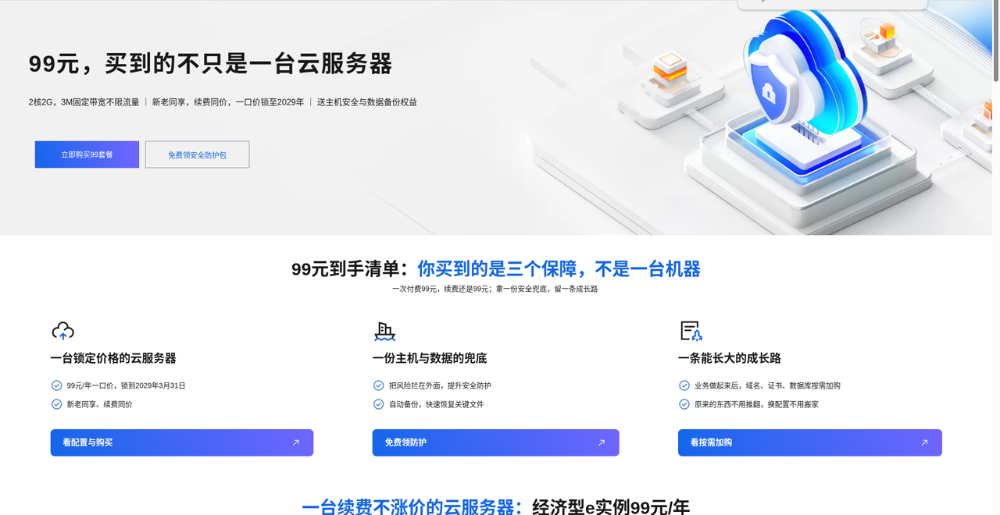
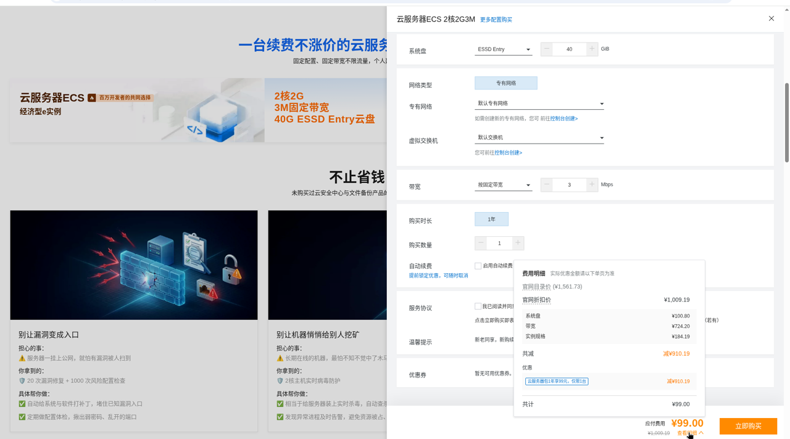
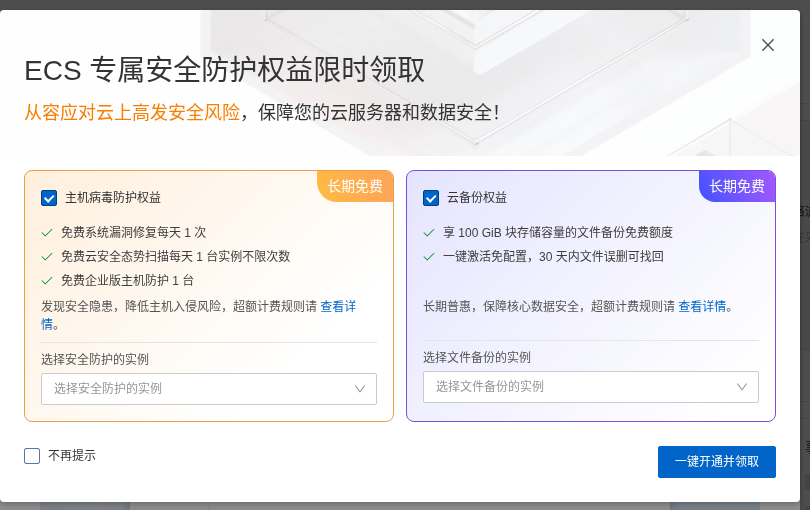
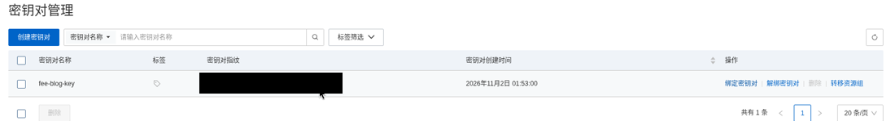
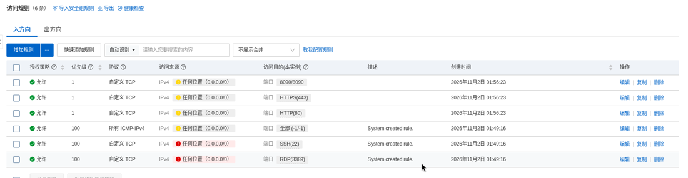
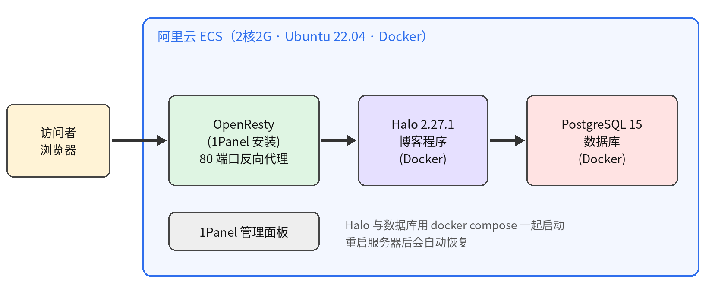
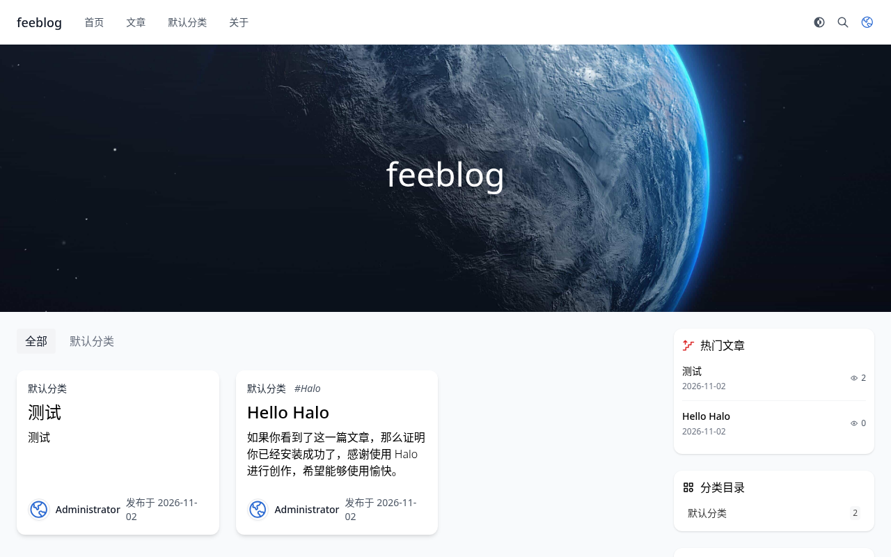
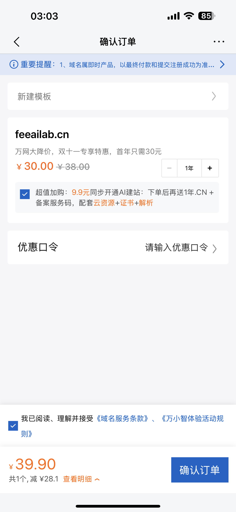
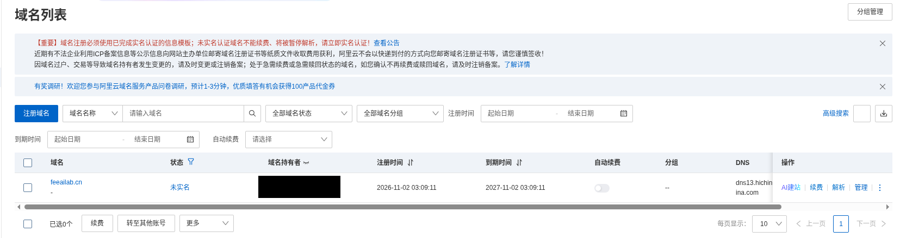
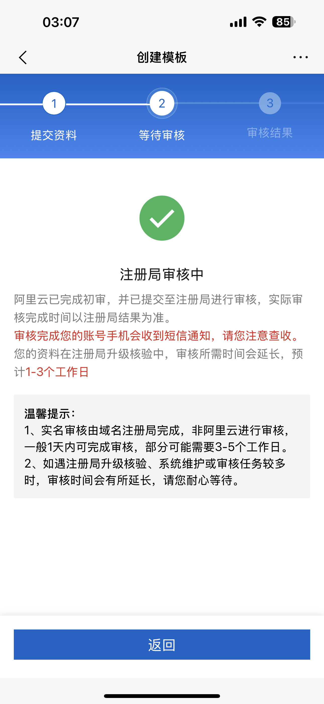

# 从零开始：我花 129 元搭好了个人博客服务器（小白全记录）

> 📚 系列文章：**第 1 篇（本文）买服务器、装博客** → [第 2 篇：备案通过后绑域名、开 HTTPS、挂备案号](https://github.com/feiw3440-cell/halo-blog-domain-https-icp)
> 2026 年 11 月 2 日，一天时间：选服务器 → 下单 → 安全配置 → 装博客 → 买域名。这篇文章把我踩过的坑和花的钱都写出来，希望能帮到同样想搭个人网站的你。

## 一、为什么想自己搭网站

我想做一个**个人博客兼作品集**，主要给国内的朋友和同行看。再往后，我还打算把自己做的 **CRM、ERP、SCM 这类软件的 demo** 放上去，让别人点个链接就能登录试用。

访客主要在国内，所以我决定选**国内的云服务器**：访问速度快，代价是要做 **ICP 备案**（备案通过之前，域名不能对外开放）。

一开始我也想过"一步到位"，直接上 4 核 8G 来跑业务系统。算了一下，一年大概要 **1500～6000 元**，对现在只想先把博客立起来的我来说太贵了。所以我的策略是：**先用最便宜的方案把博客跑起来，以后要跑重的 demo，再升级配置。**

## 二、服务器怎么选：三家对比

我对比了三个方案：

| 方案 | 配置 | 价格 | 备注 |
|---|---|---|---|
| **阿里云 ECS 经济型 e** | 2 核 2G，3M 固定带宽，不限流量，40G ESSD Entry | **99 元/年** | 续费同价，锁定到 2029-03-31；支持备案 |
| 阿里云轻量应用服务器 | 入门款 | 新用户 38 元 / 68 元 | 第二年价格我没核实到官方说法 |
| 腾讯云 Lighthouse | 2 核 2G | 新用户 68 元 | 续费约 459 元/年 |

最后我选了**阿里云 ECS 99 元这一档**，理由很简单：

1. **续费同价**，官方写明锁到 2029 年 3 月，不会"第一年便宜、第二年暴涨"；
2. **固定带宽、不限流量**，不用担心被流量账单吓到；
3. **支持备案**，而且账号、服务器、域名都在同一家，后面办事方便。

> 小提醒：另外两家第一年更便宜，但要看清第二年的续费价。便宜的"首年价"如果次年翻几倍，长期算下来未必划算。

## 三、注册、实名、下单

### 1. 注册账号并实名

注册阿里云账号后，要先做**个人实名认证**。我用的是支付宝授权，几分钟就搞定。**没有实名，买不了活动价，也没法备案**，所以这一步一定要先做。

### 2. 下单配置

我的选择如下：

- 地域：**华东 1（杭州）**（⚠️ 地域买完就**不能改**，建议选离大部分访客近的）
- 系统：**Ubuntu 22.04**
- 时长：1 年，没开自动续费
- 官网原价 ¥1,009.19，活动优惠后 **¥99**，用支付宝付款

上图右下角点开"费用明细"，可以清楚看到原价和优惠。**付款前一定要看一眼费用明细和续费价**，别被默认勾选的附加项带偏。

付款成功后，控制台会弹出一个"ECS 专属安全防护权益"的领取窗口，是免费的主机安全和云备份额度，按需领取即可。

## 四、先把门锁好：安全设置

服务器一开机，就会有机器人不停地扫描、尝试登录。所以**第一件事不是装软件，而是把安全做好**。

### 1. 用 SSH 密钥登录，不用密码

下单时我没有设置登录密码，正好改用更安全的 **SSH 密钥（ed25519）**：

1. 在自己的电脑上生成一对密钥；
2. 把公钥导入阿里云控制台的"密钥对"；
3. 把密钥对**绑定到服务器**。

绑定的时候阿里云会向实名手机发一条**短信验证码**，确认后服务器会**自动重启一次**。因为这时机器上还没有任何东西，重启没有影响，这也是"先配安全、再装东西"的好处。

绑好之后，我还**关闭了密码登录**，以后只有持有私钥的人才能连进来。

> 私钥只放在自己电脑上，**不要发给任何人、不要上传到网盘**。

### 2. 安全组只开必要的端口

安全组相当于服务器外面的"门禁"。我放行了：

- **22**：SSH 登录
- **80**：网站 HTTP 访问
- **443**：以后启用 HTTPS
- 以及 1Panel 管理面板用的端口

控制台对"来源是任何位置"的规则会标黄或标红提醒。熟悉之后，可以把 22 端口和面板端口的来源限制为自己的 IP，更安全。

## 五、在服务器上装了什么

登录服务器后，我按这个顺序来：

1. **系统更新**，并设置好时区；
2. 建一个 **2G 的 swap 虚拟内存**，2G 内存的机器有它会稳很多；
3. 开启 **unattended-upgrades**，让系统自动装安全补丁；
4. 安装 **Docker CE**，用的是阿里云镜像，并配置了镜像加速（registry mirrors）；
5. 安装 **1Panel v2.4.2** 管理面板，入口用了随机路径（"随机安全入口"），不容易被扫到；
6. 通过 1Panel 装 **OpenResty**，在 80 端口做反向代理；
7. 用 **docker compose** 部署 **Halo 2.27.1 + PostgreSQL 15**。

整体结构大概是这样：

### 为什么不用 1Panel 应用商店里的 Halo？

我一开始想点点鼠标一键装好，结果发现应用商店里的 Halo 会拉取**付费版 halo-pro** 的镜像。我只想要免费的开源版，所以放弃了一键安装，改成自己写 docker compose，把 Halo 和 PostgreSQL 一起拉起来。这样每个组件的版本都在自己手里。

### 踩坑：镜像拉取很慢，OpenResty 一直超时

这是今天最折腾人的地方。在国内服务器上拉 Docker 镜像，速度大约只有 **1MB/s**，稍大一点的镜像就要等很久。其中 **OpenResty 的镜像多次拉取超时**，反复重试才成功。

经验是：**一定要配置镜像加速**，拉取失败不要慌，多重试几次，耐心等待。

### 装完要重启验证

所有东西装好后，我故意把服务器**重启了一次**，确认 Docker、数据库、博客都会自动恢复。这一步很重要：不然哪天服务器被动重启，网站就一直打不开了。

重启后实测：内存用了大约 **770MB**（总共约 1.7GiB），对博客来说很宽裕。

## 六、打开浏览器，初始化 Halo

在浏览器输入服务器的公网 IP，就会看到 Halo 的初始化页面。填写站点名称，设置自己的管理员用户名、邮箱和密码（这个密码只有自己知道），提交后就能进入后台写文章、换主题了。

看到自己的博客第一次出现在浏览器里的那一刻，真的很有成就感 🎉。

## 七、买一个属于自己的域名

我想要一个跟 **AI** 有关的名字，查了几个：`feeai.cn`、`aifee.cn` 已经被注册了。最后选了 **feeailab.cn**（"Fee 的 AI 实验室"），以后放博客和 demo 都合适。

- .cn 域名首年 **30 元**，续费每年 **42 元**；
- 域名需要先建一个**实名模板**，我是在手机上用身份证信息创建的；
- 购买页有一个 **9.9 元的"AI 建站"超值加购**，我没有勾选：博客已经自己搭好了，不需要。

付款后，域名已经出现在账号里，不过状态是**"未实名"**：实名模板还在注册局审核，一般需要 **1～3 个工作日**。

## 八、费用小结

| 项目 | 费用 | 说明 |
|---|---|---|
| 阿里云 ECS 经济型 e（1 年） | 99 元 | 原价 ¥1,009.19，续费同价 |
| 域名 feeailab.cn（首年） | 30 元 | 次年续费 42 元 |
| 9.9 元 AI 建站加购 | 0 元 | 没买 |
| **今天合计** | **129 元** | |

## 九、避坑 / 心得

1. **先实名，再下单。** 没实名买不了活动价，也备不了案。
2. **看清续费价。** 很多"新用户价"只管第一年，下单前一定确认第二年的价格。
3. **地域买完不能改。** 选离主要访客近的地方。
4. **先配安全，再装软件。** SSH 密钥登录 + 关闭密码登录，只开必要端口。
5. **国内拉 Docker 镜像很慢。** 配镜像加速，超时就重试，别急。
6. **别盲目点"一键安装"。** 先看看它装的是不是你想要的版本（比如我遇到的付费版 Halo）。
7. **装完要重启验证。** 确保自动恢复。
8. **别乱勾加购。** 有些东西你已经有了，不需要重复买。
9. **私钥、密码只留在自己手里。** 不要发给别人，也不要贴在截图里。

## 十、接下来要做的事

- ⏳ 等域名**实名审核**通过（1～3 个工作日）；
- 📝 提交 **ICP 备案**：服务器需要买满 3 个月以上，备案人和域名实名信息要一致，还要用阿里云 App 做一次人脸核验，预计 **1～22 个工作日**；
- 🔗 备案通过后，把域名解析到服务器，并开启 **HTTPS**；
- 🚀 在**子域名**上部署我自己做的 CRM/ERP/SCM demo，让大家点个链接就能试用。

备案期间，博客在备案通过之前还不能用域名对外开放，我会先用它写文章、选主题、打磨内容。等一切就绪，我再来更新这个系列。

如果你也想搭自己的网站，希望这篇流水账能帮你少走几步弯路。有问题欢迎留言交流！

---

**下一篇** 👉 [备案通过之后：给 Halo 博客绑上 feeailab.cn、开 HTTPS、挂备案号的完整记录](https://github.com/feiw3440-cell/halo-blog-domain-https-icp)
